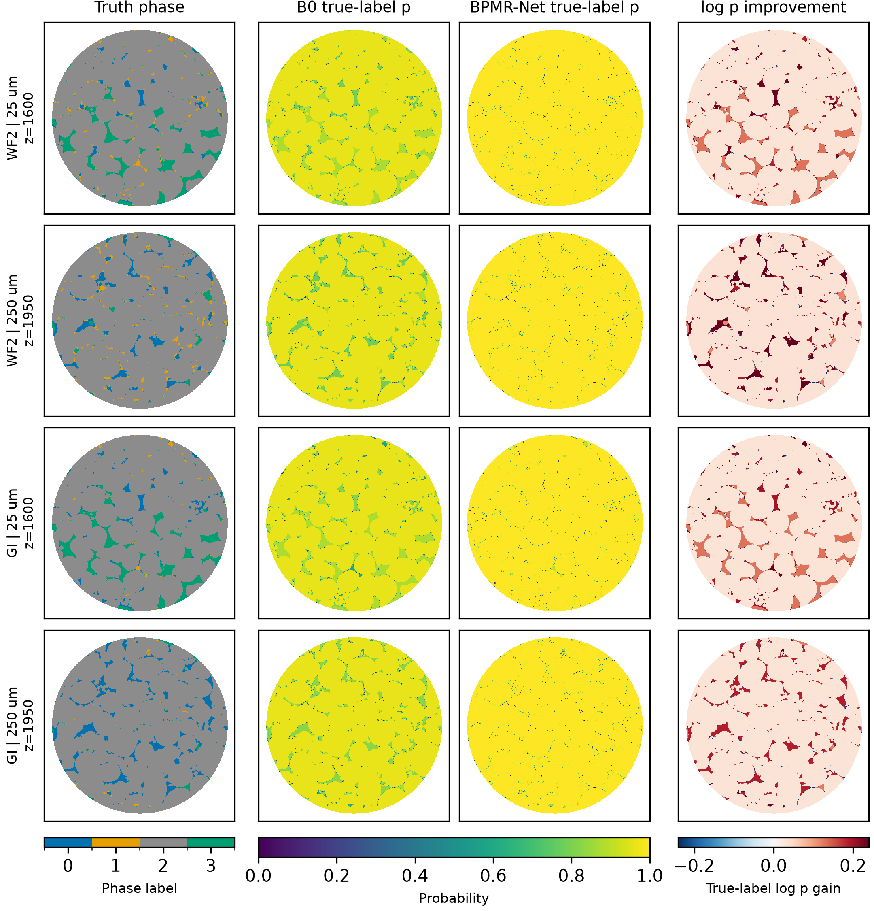

# BPMR-Net

BPMR-Net is a masked multi-receptive residual refinement model for
sparse-section microstructure reconstruction. It refines a frozen B0 local
categorical predictor while preserving explicit support-mask semantics and a
deterministic probability-fusion contract.

This repository is the sanitized public release. It contains executable model
code, feature encoding, fusion rules, tests, a synthetic demo, and the paper
workflow entry points. Raw WF2/GI volumes, private server paths, training
checkpoints, and internal development archives are intentionally excluded.

Associated manuscript:

> Ying Qin, Dawang Zhang, and Yidong Qiao. *Sparse-section reconstruction of
> multiphase microstructures through baseline-preserving residual probability
> refinement* (2026).



## Method at a glance

- **B0 input:** 80 neighbors in a 9 x 9 window, excluding the center.
- **Feature width:** four phase channels plus one support-mask channel per
  neighbor, producing 400 features.
- **BPMR-Net:** three masked depthwise branches with dilation 1, 2, and 4,
  followed by a gated residual correction over frozen B0 logits.
- **Trainable refinement size:** 383 parameters.
- **Template fusion:** normalized equal-weight mean of four phase-template
  probabilities.
- **Orientation fusion:** normalized equal-weight mean of x, y, and z outputs.
- **ES-BPMR:** uses BPMR-Net when B0 entropy is at least
  `0.12690064311027527`; otherwise it uses B0.

## Installation

Python 3.10 or newer is required.

```bash
python -m venv .venv
source .venv/bin/activate          # Windows: .venv\Scripts\activate
python -m pip install --upgrade pip
python -m pip install -e ".[dev,paper]"
```

Conda users can instead run:

```bash
conda env create -f environment.yml
conda activate bpmr-net
```

Install the PyTorch build appropriate for your CPU/CUDA platform if the
default resolver does not match your system.

## Quick smoke test

```bash
bpmr-net-demo --seed 1701 --size 24
pytest
```

The demo constructs a synthetic four-phase field, encodes 400-D features,
runs frozen B0 and BPMR-Net, and verifies normalized output probabilities.

## Minimal Python example

```python
import torch

from bpmr_net import BPMRNet, build_b0_model

b0 = build_b0_model(seed=1701)
model = BPMRNet(b0)
features = torch.zeros(16, 400)

with torch.no_grad():
    _, bpmr_probability, _, b0_probability = model(features)

print(model.trainable_parameter_count)  # 383
print(bpmr_probability.shape)           # torch.Size([16, 4])
```

## Repository layout

```text
src/bpmr_net/        installable model and probability code
tests/               fast public tests
configs/             portable example configuration
scripts/             data/checkpoint verification utilities
paper_reproduction/  frozen paper workflow entry points and migration notes
data/                 dataset access and integrity instructions
checkpoints/          model-release layout and checksum instructions
docs/                 scope, provenance, and visual assets
```

## Paper reproduction

The original factorial execution used two materials, three sampling regimes,
three methods, two paired training seeds, and five reconstruction seeds.
The original scripts are retained in `paper_reproduction/` for traceability.

They require data manifests and checkpoints that are not stored in Git. Start
with [paper_reproduction/README.md](paper_reproduction/README.md) and copy
`configs/factorial_v2.example.json` to a local, untracked configuration file.

The implementation identifiers used by the paper are:

| Implementation ID | Manuscript name |
|---|---|
| `B0` | B0 |
| `ORIGINAL_R2` | BPMR-Net |
| `SELECTIVE_V2` | ES-BPMR |

## Data and checkpoints

The raw WF2/GI volumes are third-party research data and are not redistributed
here. See [data/README.md](data/README.md) for filenames, SHA-256 values, and
the expected directory layout.

Checkpoints should be distributed through a versioned release or research-data
repository, with checksums, rather than committed to ordinary Git history. See
[checkpoints/README.md](checkpoints/README.md).

## Scope and scientific limitations

- The formal study used two fixed source volumes; stochastic seeds are not
  independent material specimens.
- The sampling interval was not isolated from section count and observation
  density.
- B0 is an implementation-level reference, not a reproduced literature
  benchmark.
- The synthetic demo validates software behavior, not scientific performance.
- Dense truth must not be used during model training or reconstruction.

## Citation

The citation record is in [CITATION.cff](CITATION.cff). Add the final journal,
volume, pages, and DOI after publication.

## Contributing and security

See [CONTRIBUTING.md](CONTRIBUTING.md) and [SECURITY.md](SECURITY.md). Do not
open public issues containing private dataset links, credentials, access
tokens, unpublished reviewer correspondence, or restricted checkpoint URLs.

## License

The code is licensed under Apache-2.0. Dataset files and third-party artifacts
retain their own licenses and are not relicensed by this repository.

---

## 中文说明

这是 BPMR-Net 的独立开源整理版。主仓库只包含可安装代码、测试、合成示例、
配置模板和论文复现入口，不包含服务器密码、绝对路径、WF2/GI 原始数据、完整
checkpoint 或内部审计历史。

作者、论文题目、GitHub 地址和 Apache-2.0 许可状态已经确认；论文正式发表后还需补充期刊信息和 DOI。
